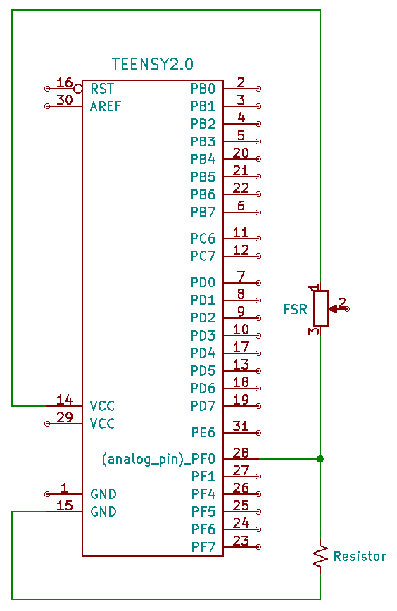

# DanceMicro

4-panel dance pad controller firmware for ATmega23U4. Written in C with LUFA. 

## Features
- Reads directly from 4 FSR sensors using registers. 
- Press and release thresholds per panel for noise reduction. 

## Assumptions
- 5V Supply to AVcc. 
- Panels connected to A0-A3 (ADC7-ADC4) pins.

## Requirements
avr-gcc, avr-libc, avrdude, make

## Build
    git clone --recurse-submodules https://github.com/hojinc02/ddr-mc
    cd <repo-root>/DanceMicro
    make

## Flash
Double-tap the reset button and run [flash_cmd.sh](DanceMicro/flash_cmd.sh). 

## Tuning
`make clean && make` after writing the thresholds into the [makefile](DanceMicro/makefile). Valid range is 0-1023. 

## Wiring
Follow sereni's [fsr-pad-guide](https://sereni.github.io/fsr-pad-guide/) to learn about FSR's and how to wire correctly for your setup. 

Here is an example wiring from the guide. 

## Credit
Built on [LUFA](lufa). Descriptor files copied from LUFA's joystick demo. 